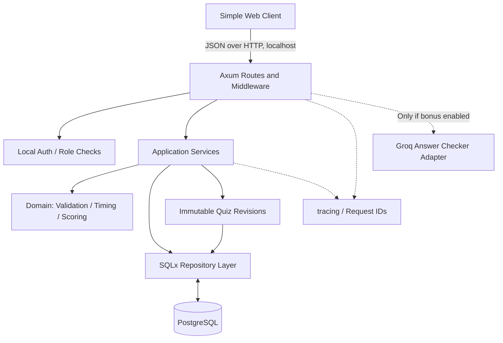
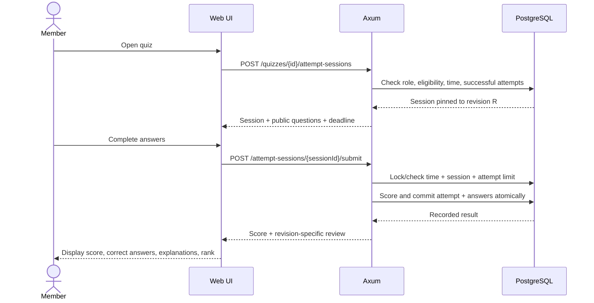
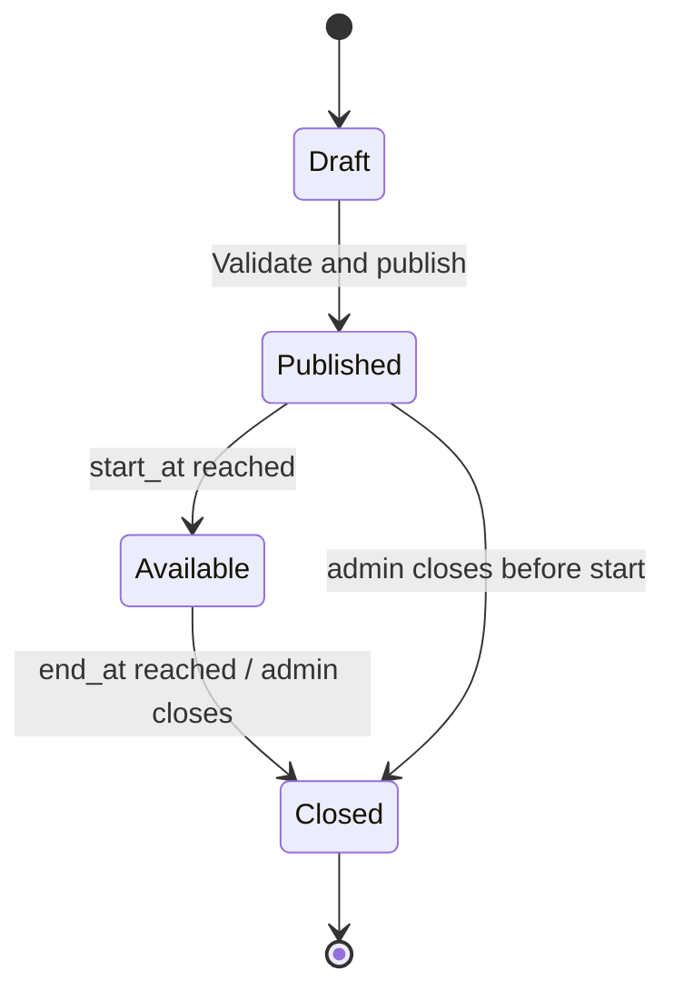
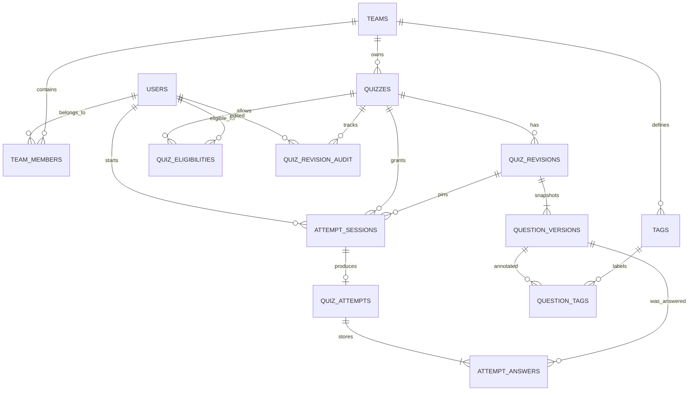
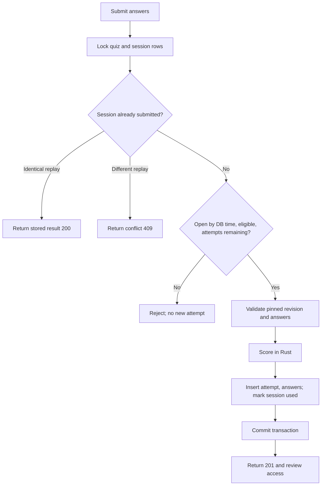
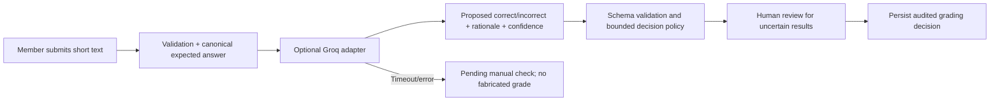

# StandupPulse / DailyQuiz Engine — System Design

**Version:** 2.0 (revised MVP)  
**Status:** Proposed; implementation not yet verified  
**Delivery target:** Three development days, four engineers, local Docker Compose deployment  
**Source:** Revised from the team's original end-to-end system design and the six "What Can Go Wrong?" decisions supplied on 17 November 2026.

> **Scope rule:** Complete the deterministic quiz platform first. **Groq-assisted checking of one-line answers is a bonus feature**, owned by Member 3, and must not block the MVP.

---

## 1. Executive Summary

StandupPulse is a team quiz and knowledge-retention application. Admins manage quizzes; eligible members answer within a fixed time window, receive scores and explanations after submitting, and view their own performance and rank. Admins see team-wide analytics. The system preserves quiz/question revisions so an admin can edit questions after attempts exist without silently rewriting the meaning of earlier submissions.

**Stack:** Rust, Tokio, Axum, Serde, SQLx, PostgreSQL, `tracing`, Docker Compose, GitHub Actions; simple local web frontend.  
**Architecture:** Modular Rust monolith: API handlers → application services → domain rules → SQLx repositories → PostgreSQL.  
**Identity for this local MVP:** Application-managed accounts using **Argon2id password hashes** and signed, expiring session/access tokens. No OIDC integration required for the three-day build. Never use reversible ASCII shifts, homemade encryption, or plain SHA-256 as password storage.

### 1.1 Goals

- Team authentication and authorization; admin/member separation.
- Validated quiz creation, timed availability, question editing, and configurable attempt limits.
- Database-safe scoring, submit retries, answer visibility, and rank computation.
- Auditable history of edits and attempts; no accidental retroactive grade changes.
- Testable Rust modules, structured logging, CI, and repeatable local execution.
- Optional searchable archive for historical questions.

### 1.2 Locked MVP decisions and changes from v1

| Area | Revised decision | Change from original |
|---|---|---|
| Question types | Multiple choice (MCQ), exactly one correct option | Retained |
| Questions/options | 1–50 questions; 2–6 nonblank options each | Retained |
| Quiz window | Default **15 minutes**, e.g. **11:00:00 ≤ time < 11:15:00** | Added |
| Attempts | Admin sets `max_attempts` to **1 or 2** before publishing; every successful new submission consumes one | Replaces fixed one-attempt rule |
| Submissions | All questions answered; server computes 1 point per correct answer | Retained |
| Duplicate requests | Identical retry for the **same attempt session** returns the saved result; a true retake requires a new session | Updated for multiple attempts |
| Question changes | Admin may edit after publication and after a candidate has submitted; every edit creates an immutable **quiz revision** | Replaces draft-only editing |
| Existing scores | Stored scores stay tied to their original revision; **no automatic historical regrading** | Explicit safeguard |
| Closing | Automatically unavailable at end of window; admin may close earlier | Added scheduled cutoff |
| Correct answers | Visible to the **owner of a submitted attempt immediately after submission** | Replaces reveal-only-after-close |
| Admin analytics | Submissions, user scores, attempt history, averages, participation and revision-aware performance | Expanded |
| Member analytics | Own results, detailed review and rank **within the quiz revision** | Expanded/limited access |
| Authentication | Local registration/login with Argon2id; no OIDC in MVP | Replaces OIDC provider |
| Knowledge vault | Historical search, with authorization and answer-visibility safeguards | Retained; deprioritize behind core features |
| AI answers | Groq checks short free-text answers **only in bonus scope** | New, bonus only |

### 1.3 Clarifications needed before the first pull request

The choices above are the **implementation defaults** for this design, not proof that the team already agreed to every detail. Confirm them at kickoff: (a) a started but unsubmitted session does **not** consume an attempt; (b) editing does **not** automatically change past scores; (c) rankings are per revision because questions can change; and (d) answer explanations are shown immediately after submission even if the quiz remains open. These choices prevent divergent implementations.

---

## 2. High-Level Architecture



| Layer | Responsibility | Primary owner |
|---|---|---|
| Web UI | Login, quiz list, countdown, submit, review, personal/admin dashboard | Member 4 (thin UI) |
| API / security | Axum routing, DTOs, local auth, role checks, error mapping | Member 3 |
| Application services | Orchestrate creating, revising, starting, submitting and reviewing | Member 2; Member 3 connects routes |
| Domain | Pure time-window rules, validation, scoring and ranking policy | Member 2 |
| Repositories / schema | Migrations, SQLx queries, transactions and constraints | Member 1 |
| DevOps / observability | Docker Compose, CI, configuration, structured logs and probes | Member 4 |
| Optional AI integration | Groq model adapter and guarded short-answer verification | Member 3 **bonus only** |

**Design principle:** The database decides authoritative state; the browser's timer and the Rust runtime cannot override the cutoff or attempt limit. Prefer pure, synchronous Rust functions for scoring and async Rust only for I/O.

---

## 3. Product Journeys

### 3.1 Admin journey

1. Register/login and belong to a team with the `admin` role.
2. Create a draft quiz; enter title, start time (or start now), default 15-minute duration, and `max_attempts` 1 or 2.
3. Create and validate MCQs, options, correct indices and explanations.
4. Publish; capture the eligible-member snapshot and revision 1.
5. See attempts and team analytics. Admin may correct questions after attempts exist; the edit creates a new revision and must include a change reason.
6. Let the deadline close availability automatically, or close early.
7. Review attempts and revision history. Past score corrections require an explicitly designed regrade operation, **not** a silent rewrite.

### 3.2 Member journey

1. Login and choose an eligible team quiz.
2. The UI displays the opening/closing time and remaining duration. Starting is permitted only while the quiz is effectively open and attempts remain.
3. `POST /attempt-sessions` creates a one-use server-side session pinned to a specific question revision.
4. The member retrieves the public questions for that session, answers them, and submits before cutoff.
5. On successful submission, the member immediately sees **that attempt's** score, correct answers and explanations.
6. If configured for two attempts, the member may create a second session before cutoff; rank and personal dashboard update after submission.
7. At cutoff, no further starts or submissions are accepted; submitted history remains accessible.



---

## 4. Business Rules and Failure Modes

### 4.1 Quiz lifecycle and timing



`Published` and `Available` above represent *effective* states for display. Store `draft`, `open`, `closed` in `quizzes.status`; calculate effective availability from `starts_at`, `ends_at`, and `manually_closed_at` on **each relevant API operation**. A background job is **not** required to enforce closing: the database-backed time check is sufficient even if no cron job runs. An optional cleanup job may update persisted status for dashboards.

- Default `ends_at = starts_at + INTERVAL '15 minutes'`.
- Time uses **database server UTC** (`clock_timestamp()`), stored as PostgreSQL `TIMESTAMPTZ`; user-facing examples are displayed in local time.
- Start time is inclusive; end time is exclusive. **11:15:00 is already too late** in the example. Do not allow an extra grace second until 11:15:01.
- The frontend countdown freezes at zero and disables controls for usability, but the API must also reject late requests.
- Admin manual closure is immediate for subsequent requests; it uses the same transactional guard as submission.
- Time cannot be trusted from client payloads or browser clocks.

**Illustration:** A quiz available from **11:00:00 to 11:15:00** accepts a valid new attempt/submission at 11:14:59 (subject to server validation), not at 11:15:00 or 11:16.

### 4.2 Question changes even after submissions

**Yes, admins can edit after a candidate has submitted.** Edits create a new complete, immutable quiz snapshot:

- `quiz_revisions` stores revision number, editor, timestamp and edit reason.
- `question_versions` stores the complete questions, options, correct answer and explanation for that revision.
- Every `attempt_session` pins one `revision_id` when created. An ongoing member keeps seeing that revision even if the admin edits the quiz.
- Every submitted attempt references the pinned revision and is scored against it. New sessions see the newest published revision.
- Old attempts and their scores **do not change automatically**. This avoids corrupting historical evidence or making a previous answer appear wrong under a new key.
- Admin UI must show a warning: **"This creates a new revision; earlier scores remain as recorded."** Show revision number with each result and in analytics.
- The admin may not delete historical revision rows that are referenced by attempts.

**Deferred policy:** If the team later requires retroactive score changes, add an explicit `POST /quizzes/{id}/regrade` action with authorization, preview, audit record, original-score preservation and a documented rank recalculation. It is **not part of the three-day MVP**. This resolves the user's observation that edits *may* affect scores without silently or unpredictably changing already recorded results.

### 4.3 Maximum attempts and duplicate submits

- The admin chooses `max_attempts ∈ {1, 2}` before publishing. It cannot be changed after publishing in the three-day MVP (avoid moving limits beneath live sessions).
- **One successful new submission** counts as one consumed attempt. Starting a session, failing validation or timing out without submitting does not consume an attempt.
- At most **one in-progress session** per `(quiz_id, user_id)` is allowed; a new session can be started when the prior session is submitted or expired.
- On submit, enforce `successful_attempts < max_attempts` while holding the quiz/user submission lock; assign `attempt_no` 1 or 2, with `UNIQUE (quiz_id, user_id, attempt_no)`.
- A repeated request for the **same session with identical canonical answers** returns its stored result with `200 OK`, and never consumes an additional attempt—even after quiz closure.
- A retry for the same already-used session with **different** answers returns `409 Conflict`; to use attempt 2, create a new session.
- Two concurrent submissions for the same user cannot allocate the same attempt number or exceed the limit. Use PostgreSQL transactions, locks and uniqueness, not a process-local `Mutex`.

| Situation | Expected result |
|---|---|
| Max 1, first successful submit | Saved as attempt 1; no new session permitted |
| Max 1, repeat identical HTTP submit for same session | Same saved attempt returned (idempotent) |
| Max 2, first successful submit | Attempt 1; one successful attempt remains |
| Max 2, second new session/submission | Attempt 2; no additional attempts permitted |
| Any max, same session re-submitted with different answers | `409 SESSION_ALREADY_SUBMITTED` |
| Started but not submitted by deadline | Session expires; **not** counted as a completed attempt |

### 4.4 Admin closes during submission

The API must serialize cutoff/close decisions against submissions using a transaction and quiz-row lock. The server captures the authoritative decision time **after acquiring the lock** and checks both `clock_timestamp() < ends_at` and whether the admin has already closed the quiz. It then validates and commits the result. An admin close operation uses the same quiz row lock.

- If the close wins the lock, the subsequent submission fails.
- If a submission wins before closure **and passes the cutoff test**, it can complete and commit, even if the response reaches the browser after closure. The user did not initiate a new valid submission after the deadline.
- If the submission reaches admission logic at/after the cutoff, it is rejected even if the browser appeared to have time left.
- A committed session can still be **idempotently replayed** to recover a result; this is not a new submission.
- Never use a stored transaction-start `NOW()` value as a proxy for elapsed wall time while waiting for locks; read `clock_timestamp()` at the decision point.

This explicitly defines the edge case rather than promising that a database commit can always finish before a wall-clock boundary. If stricter *commit-before-deadline* behavior is mandatory, it needs a stronger policy and separate testing.

### 4.5 Correct answers and explanations

- Before a member submits, public quiz/session responses **never** expose `correct_option_index`, explanation, or equivalent flags.
- After a successful submission, **only that attempt's owner** can fetch its correct answers and explanations, matched to the revision they submitted.
- Admins can inspect answer keys as quiz editors and view complete analytics.
- A member who has not submitted cannot retrieve another member's review, even if the quiz closes.
- Immediate answer reveal creates an explicit **fairness trade-off**: with two attempts, a member can see the correct answers after attempt 1; participants can also share them before closing. This is the requested product policy, not an anti-cheating guarantee. Keep it visible in admin settings and demo documentation.
- The knowledge vault exposes answers only to users whose own relevant attempt is submitted, or via a separate team-wide release policy **after closure**. For simplicity in the MVP, show team-wide archived answer keys only after closure; owner review remains immediate.

### 4.6 Analytics and authorization

**Admin:** all users' submissions, per-attempt scores, latest/best score, participant count, revision, mean score, completion percentage and ranking summaries.  
**Member:** only their own attempts, per-question correctness/explanations and their own rank for the revision; no other member's detailed answer sheet or private score list.

With two attempts, define the headline score as **best percentage** per `(user, quiz, revision)` and expose the full attempt history separately. Participation rate counts **distinct users** who submitted at least once, not total submissions. Rank uses competition ranking within a revision: equal best percentages share rank (1, 1, 3). Different revisions are not assumed to be equally difficult; label revision-specific ranks and do not silently combine them.

### 4.7 Access-control matrix

| Operation | Team admin | Eligible member | Nonmember |
|---|---|---|---|
| Create quiz / publish / close / edit revisions | Yes | No | No |
| Change attempt limit before publishing | Yes | No | No |
| View quiz questions while available | Yes | Yes | No |
| Start / submit attempt | If eligible | If eligible | No |
| See correct answers before own submit | As editor only | No | No |
| See own submitted review | Yes | Yes | No |
| See another member's review and all scores | Yes | No | No |
| See own rank and detailed result | Yes | Yes | No |
| See aggregate team analytics | Yes | No | No |
| Search post-close team-wide archive | Yes | Team member | No |

---

## 5. Data Model

### 5.1 Entity relationships



### 5.2 Suggested PostgreSQL migration (`migrations/0001_init.sql`)

This is the **contract to implement and test**, not a statement that a migration has already been applied. The team may split it into ordered migration files. Use database constraints plus application-level transactional validation for invariants that cannot be expressed in a simple `CHECK`.

```sql
CREATE TABLE users (
    id UUID PRIMARY KEY DEFAULT gen_random_uuid(),
    username VARCHAR(50) NOT NULL UNIQUE,
    email VARCHAR(254) NOT NULL UNIQUE,
    password_hash TEXT NOT NULL,
    created_at TIMESTAMPTZ NOT NULL DEFAULT clock_timestamp()
);

CREATE TABLE teams (
    id UUID PRIMARY KEY DEFAULT gen_random_uuid(),
    name VARCHAR(100) NOT NULL UNIQUE,
    created_at TIMESTAMPTZ NOT NULL DEFAULT clock_timestamp(),
    deleted_at TIMESTAMPTZ
);

CREATE TABLE team_members (
    team_id UUID NOT NULL REFERENCES teams(id),
    user_id UUID NOT NULL REFERENCES users(id),
    role TEXT NOT NULL CHECK (role IN ('admin', 'member')),
    joined_at TIMESTAMPTZ NOT NULL DEFAULT clock_timestamp(),
    PRIMARY KEY (team_id, user_id)
);

CREATE TABLE quizzes (
    id UUID PRIMARY KEY DEFAULT gen_random_uuid(),
    team_id UUID NOT NULL REFERENCES teams(id),
    created_by UUID NOT NULL REFERENCES users(id),
    title VARCHAR(150) NOT NULL,
    description TEXT,
    status TEXT NOT NULL DEFAULT 'draft'
        CHECK (status IN ('draft', 'open', 'closed')),
    starts_at TIMESTAMPTZ,
    ends_at TIMESTAMPTZ,
    manually_closed_at TIMESTAMPTZ,
    max_attempts SMALLINT NOT NULL DEFAULT 1 CHECK (max_attempts IN (1, 2)),
    created_at TIMESTAMPTZ NOT NULL DEFAULT clock_timestamp(),
    CHECK (starts_at IS NULL OR ends_at IS NULL OR ends_at > starts_at),
    CHECK (status = 'draft' OR (starts_at IS NOT NULL AND ends_at IS NOT NULL))
);

CREATE TABLE quiz_revisions (
    id UUID PRIMARY KEY DEFAULT gen_random_uuid(),
    quiz_id UUID NOT NULL REFERENCES quizzes(id),
    revision_no INT NOT NULL CHECK (revision_no > 0),
    created_by UUID NOT NULL REFERENCES users(id),
    change_reason TEXT NOT NULL,
    created_at TIMESTAMPTZ NOT NULL DEFAULT clock_timestamp(),
    UNIQUE (quiz_id, revision_no),
    UNIQUE (quiz_id, id)
);

CREATE TABLE question_versions (
    id UUID PRIMARY KEY DEFAULT gen_random_uuid(),
    quiz_revision_id UUID NOT NULL REFERENCES quiz_revisions(id),
    stable_question_id UUID NOT NULL,
    position INT NOT NULL CHECK (position >= 0),
    question_text TEXT NOT NULL CHECK (length(trim(question_text)) > 0),
    options JSONB NOT NULL,
    correct_option_index INT NOT NULL,
    explanation TEXT NOT NULL DEFAULT '',
    UNIQUE (quiz_revision_id, position),
    UNIQUE (quiz_revision_id, stable_question_id),
    UNIQUE (quiz_revision_id, id),
    CHECK (jsonb_typeof(options) = 'array'),
    CHECK (jsonb_array_length(options) BETWEEN 2 AND 6),
    CHECK (correct_option_index >= 0
        AND correct_option_index < jsonb_array_length(options))
);

CREATE TABLE quiz_eligibilities (
    quiz_id UUID NOT NULL REFERENCES quizzes(id),
    user_id UUID NOT NULL REFERENCES users(id),
    PRIMARY KEY (quiz_id, user_id)
);

CREATE TABLE attempt_sessions (
    id UUID PRIMARY KEY DEFAULT gen_random_uuid(),
    quiz_id UUID NOT NULL REFERENCES quizzes(id),
    user_id UUID NOT NULL REFERENCES users(id),
    quiz_revision_id UUID NOT NULL,
    status TEXT NOT NULL DEFAULT 'in_progress'
        CHECK (status IN ('in_progress', 'submitted', 'expired')),
    started_at TIMESTAMPTZ NOT NULL DEFAULT clock_timestamp(),
    FOREIGN KEY (quiz_id, user_id)
        REFERENCES quiz_eligibilities(quiz_id, user_id),
    FOREIGN KEY (quiz_id, quiz_revision_id)
        REFERENCES quiz_revisions(quiz_id, id),
    UNIQUE (id, quiz_id, quiz_revision_id)
);

CREATE UNIQUE INDEX uq_active_session_per_user_quiz
    ON attempt_sessions(quiz_id, user_id)
    WHERE status = 'in_progress';

CREATE TABLE quiz_attempts (
    id UUID PRIMARY KEY DEFAULT gen_random_uuid(),
    session_id UUID NOT NULL UNIQUE REFERENCES attempt_sessions(id),
    quiz_id UUID NOT NULL REFERENCES quizzes(id),
    user_id UUID NOT NULL REFERENCES users(id),
    quiz_revision_id UUID NOT NULL,
    attempt_no SMALLINT NOT NULL CHECK (attempt_no IN (1, 2)),
    request_hash CHAR(64) NOT NULL,
    score INT NOT NULL CHECK (score >= 0),
    total_questions INT NOT NULL CHECK (total_questions BETWEEN 1 AND 50),
    submitted_at TIMESTAMPTZ NOT NULL DEFAULT clock_timestamp(),
    UNIQUE (quiz_id, user_id, attempt_no),
    UNIQUE (id, quiz_revision_id),
    FOREIGN KEY (quiz_id, quiz_revision_id)
        REFERENCES quiz_revisions(quiz_id, id),
    FOREIGN KEY (quiz_id, user_id)
        REFERENCES quiz_eligibilities(quiz_id, user_id),
    CHECK (score <= total_questions)
);

CREATE TABLE attempt_answers (
    attempt_id UUID NOT NULL,
    quiz_revision_id UUID NOT NULL,
    question_version_id UUID NOT NULL,
    selected_option_index INT NOT NULL CHECK (selected_option_index >= 0),
    is_correct BOOLEAN NOT NULL,
    PRIMARY KEY (attempt_id, question_version_id),
    FOREIGN KEY (attempt_id, quiz_revision_id)
        REFERENCES quiz_attempts(id, quiz_revision_id),
    FOREIGN KEY (quiz_revision_id, question_version_id)
        REFERENCES question_versions(quiz_revision_id, id)
);

CREATE TABLE tags (
    id UUID PRIMARY KEY DEFAULT gen_random_uuid(),
    team_id UUID NOT NULL REFERENCES teams(id),
    name VARCHAR(50) NOT NULL,
    UNIQUE (team_id, name)
);

CREATE TABLE question_tags (
    question_version_id UUID NOT NULL REFERENCES question_versions(id),
    tag_id UUID NOT NULL REFERENCES tags(id),
    PRIMARY KEY (question_version_id, tag_id)
);

CREATE TABLE quiz_revision_audit (
    id UUID PRIMARY KEY DEFAULT gen_random_uuid(),
    quiz_id UUID NOT NULL REFERENCES quizzes(id),
    revision_id UUID NOT NULL REFERENCES quiz_revisions(id),
    editor_id UUID NOT NULL REFERENCES users(id),
    action TEXT NOT NULL,
    reason TEXT NOT NULL,
    created_at TIMESTAMPTZ NOT NULL DEFAULT clock_timestamp()
);

CREATE INDEX idx_quizzes_team_status ON quizzes(team_id, status);
CREATE INDEX idx_quizzes_window ON quizzes(starts_at, ends_at);
CREATE INDEX idx_questions_revision ON question_versions(quiz_revision_id, position);
CREATE INDEX idx_sessions_quiz_user ON attempt_sessions(quiz_id, user_id);
CREATE INDEX idx_attempts_quiz_user ON quiz_attempts(quiz_id, user_id);
CREATE INDEX idx_attempts_revision ON quiz_attempts(quiz_revision_id);
CREATE INDEX idx_attempts_submitted_at ON quiz_attempts(submitted_at);
```

**Important data invariants** enforced in application service/database transactions:

1. Only team admins can publish, close or create revisions. A revision must include 1–50 valid question rows, with nonblank string options and valid correct indices.
2. Publishing freezes `max_attempts` and takes an eligibility snapshot; every session belongs to an eligible user and to a real revision of that quiz.
3. New revisions copy the complete prior question set and then apply the requested change. Keep both old and new rows immutable after insertion.
4. A new session pins the latest revision and has at most one active session per user per quiz. **Expire stale sessions transactionally before creating another**; the partial unique index alone does not expire them.
5. Scores and `is_correct` must be computed server-side against the pinned revision, never from client-supplied values.
6. A submission must contain each pinned question exactly once, no extras, and valid option indexes.
7. A submitted attempt's quiz/user/revision must agree with its session; validate this in the transaction (the session FK alone does not enforce the equality).
8. Enforce `attempt_no ≤ quizzes.max_attempts`, uniqueness and concurrency at the database level via row-lock protocol and constraints.
9. Preserve historical revisions and submitted attempts through soft deletion; never rewrite their answer keys silently.
10. A question's tag must belong to the same team as the owning quiz; check before writing it.

**Migration note:** The SQL above is a concrete starting schema, not a substitute for testing transaction ordering, foreign-key behavior and date boundaries against real PostgreSQL.

---

## 6. API Contract (REST, `/api/v1`)

Every non-health route requires authentication unless explicitly listed as public. The server derives `user_id` from the verified token, never from an untrusted request body.

### 6.1 Identity / teams

| Method | Route | Role / behavior |
|---|---|---|
| `POST` | `/auth/register` | Public; safely hash password; validate input |
| `POST` | `/auth/login` | Public; verify Argon2id hash and issue expiring token |
| `GET` | `/me` | Authenticated profile |
| `POST` | `/teams` | Authenticated; creator becomes admin |
| `GET` | `/teams` | List user's teams |
| `POST` | `/teams/{team_id}/members` | Team admin adds members |

### 6.2 Admin quiz management

| Method | Route | Description |
|---|---|---|
| `POST` | `/teams/{team_id}/quizzes` | Create draft with `max_attempts` and start/window settings |
| `POST` | `/quizzes/{quiz_id}/questions` | Edit draft questions |
| `PATCH` | `/quizzes/{quiz_id}/questions/{stable_question_id}` | Admin change; for published quiz creates new full revision |
| `POST` | `/quizzes/{quiz_id}/publish` | Validate, generate revision 1, snapshot eligibility |
| `POST` | `/quizzes/{quiz_id}/close` | Admin closes early |
| `GET` | `/quizzes/{quiz_id}/revisions` | Admin views edit/audit history |
| `GET` | `/quizzes/{quiz_id}/analytics` | Admin-only full analytics |
| `GET` | `/teams/{team_id}/analytics` | Admin-only team analytics |

### 6.3 Member quiz/play/review

| Method | Route | Description |
|---|---|---|
| `GET` | `/teams/{team_id}/quizzes` | Available/scheduled/closed statuses; no answer keys |
| `GET` | `/quizzes/{quiz_id}` | Metadata and time window, no protected answers |
| `POST` | `/quizzes/{quiz_id}/attempt-sessions` | Start/pin revision; enforce time, eligibility and remaining attempts |
| `GET` | `/attempt-sessions/{session_id}/questions` | Owner-only public questions for pinned revision |
| `POST` | `/attempt-sessions/{session_id}/submit` | Atomically submit/score; reject if not admitted before cutoff |
| `GET` | `/attempts/{attempt_id}/review` | Owner or team admin; correct answers and explanations after submit |
| `GET` | `/quizzes/{quiz_id}/my-results` | Own score history, best score and revision-specific rank |
| `GET` | `/teams/{team_id}/knowledge?query=rust` | Authorized search; team-wide keys only after close |
| `GET` | `/health/live`, `/health/ready` | App and dependency readiness; localhost/internal as configured |

### 6.4 Examples

**Create a quiz (admin):**

```json
{
  "title": "Rust Daily Quiz",
  "starts_at": "2026-11-17T05:30:00Z",
  "duration_minutes": 15,
  "max_attempts": 2
}
```

**Submit (member):**

```http
POST /api/v1/attempt-sessions/{session_id}/submit
Authorization: Bearer <access_token>
Content-Type: application/json
```

```json
{
  "answers": [
    {"question_id": "11111111-1111-4111-8111-111111111111", "selected_option_index": 1},
    {"question_id": "22222222-2222-4222-8222-222222222222", "selected_option_index": 0}
  ]
}
```

Here `question_id` is the immutable **question-version ID** returned for that attempt session, **not** the cross-revision stable question ID.

**Result (first successful submission):**

```json
{
  "attempt_id": "33333333-3333-4333-8333-333333333333",
  "attempt_number": 1,
  "max_attempts": 2,
  "remaining_attempts": 1,
  "quiz_revision_number": 1,
  "score": 2,
  "total_questions": 2,
  "percentage": 100.0,
  "status": "submitted",
  "review_available": true
}
```

Fetch the protected review using `GET /attempts/{attempt_id}/review`; do not expose the full answer key in public quiz metadata.

### 6.5 Error contract

| Status | Example code | Meaning |
|---|---|---|
| `400` / `422` | `INVALID_ANSWER_SET` | Missing/extra/duplicate questions; malformed options |
| `401` | `UNAUTHENTICATED` | Missing/invalid token |
| `403` / `404` | `FORBIDDEN` | Wrong team, role or attempt owner |
| `409` | `ATTEMPT_LIMIT_REACHED` | Successful attempts already equal configured limit |
| `409` | `SESSION_ALREADY_SUBMITTED` | Different answers submitted to an already-used session |
| `409` | `QUIZ_NOT_AVAILABLE` | Before start, after end or manually closed |
| `409` | `ACTIVE_SESSION_EXISTS` | Another unexpired session already active |
| `413` | `PAYLOAD_TOO_LARGE` | Request too large |
| `429` | `RATE_LIMITED` | Excessive calls |
| `500` | `INTERNAL_ERROR` | Unexpected failure; no sensitive details |
| `503` | `DB_UNAVAILABLE` | Required database dependency unavailable |

```json
{
  "error": {
    "code": "ATTEMPT_LIMIT_REACHED",
    "message": "No attempts remaining for this quiz",
    "request_id": "req_example123"
  }
}
```

---

## 7. Submission Atomicity, Locking and Idempotency

A correct implementation cannot rely on frontend flags, Tokio task scheduling, or a single in-process `Arc<Mutex<_>>`.

**Session start transaction:**

1. Lock the quiz row and obtain a database-clock cutoff decision; reject if not effectively available.
2. Check membership, eligibility, completed-attempt count, and any active session; expire stale sessions.
3. Locate latest quiz revision; create one `attempt_sessions` row referencing it; commit.
4. Return session ID and public questions. A repeated start must not silently create multiple active sessions.

**Submission transaction:**

1. Begin; lock the parent quiz row and the submitting user's session row. Use consistent lock order throughout the system.
2. If this session already has a committed attempt, compare a canonical request hash: same answers → `200` stored result; different answers → `409` (this check also works after closing).
3. Otherwise check server clock against `starts_at`, `ends_at`, manual close, session ownership/status, revision and eligibility.
4. Count **successful** previous attempts under the coordinated lock. Reject if maximum reached.
5. Load exact question versions referenced by the session; ensure one valid answer per question; score on server.
6. Insert attempt and answers; assign next attempt number, mark session submitted, and commit atomically.
7. Return `201`, then enable owner-only review. If any write fails, roll back **everything**.



**Canonicalization:** Sort `(question_version_id, selected_option_index)` pairs by ID and hash a deterministic serialization. This SHA-256 request fingerprint is used **only for idempotency comparison**, not to store passwords. Handle concurrent duplicate inserts by relying on DB constraints/transaction conflicts and fetching the committed attempt; avoid assuming an uncommitted row is immediately readable.

**Lock ordering:** Admin edit/close and attempt start/submit should all lock the parent quiz row first; then any session rows. This avoids inconsistent decisions and minimizes deadlocks.

**Edge case:** If an admin edits after a session starts, the existing session stays pinned to the older snapshot. No user can submit an arbitrary revision ID supplied by the client.

---

## 8. Analytics and Knowledge Vault

### 8.1 Calculations

- `total_submissions`: all successfully submitted attempts (may exceed number of participants).
- `unique_participants`: distinct eligible users with ≥1 submitted attempt.
- `participation_rate = unique_participants / eligible_members_at_publish × 100` (null when no eligible members).
- `best_score_per_user_revision = max(attempt_percentage)` for that revision.
- `average_score_percentage`: clearly label whether averaging *all attempts* or *each member's best*; use **all attempts** by default for the admin overview.
- `rank`: order best member percentages descending **within a quiz revision**, using competition rank (`RANK()` in SQL).
- `my-results`: show each attempt number, timestamp, revision, score/total, percent, best result and own revision rank.

**Revision fairness:** Because questions/answers may change, compare performance *per revision* by default. Admin may see a cross-revision activity count but should not mistake those results for a single equal-difficulty leaderboard.

### 8.2 Searchable knowledge history

Search closed questions by text/topic/tag using PostgreSQL full-text search; support pagination. Persist a tag per question version or copy tags forward when revising. Hide answer keys from a member who has neither submitted the relevant attempt nor gained access through the team's post-close archive rule.

For the three-day build, basic closed-quiz search is a **stretch goal after core functionality**, not a release blocker if time is limited. Avoid Redis, Kafka, WebSockets and a separate search service.

---

## 9. Security

- Use Argon2id with a unique random salt for each password, through a maintained Rust library. Keep encoded hashes only. Do not decrypt passwords or invent a cipher (e.g., "add 5 to ASCII").
- Use signed short-lived tokens and verification middleware; avoid logging tokens, raw passwords, answer keys, full submitted answers or Groq credentials.
- Admin/member permissions are checked on the backend for **every resource**, not merely in the UI.
- A member can read only their own attempt review; an admin can read team-wide results for their team only.
- Employ parameterized SQLx queries, strict input validation, bounded request bodies, CORS restrictions, and login rate limiting.
- For local Docker deployment, bind the service to `127.0.0.1`; production requires TLS and appropriate secret handling.
- Use an `.env.example` with placeholders, never commit real `.env` files, database passwords or `GROQ_API_KEY`.
- Use a least-privilege application database account if feasible; migration credentials can be separate in a production hardening phase.
- Keep immutable audit records for revision changes with actor, action, reason and time.

---

## 10. Rust Repository Layout and Ownership

```text
standuppulse/
├── Cargo.toml
├── Cargo.lock
├── README.md
├── design.md
├── roadmap.md
├── .gitignore
├── .env.example
├── Dockerfile
├── compose.yaml
├── migrations/
│   ├── 0001_init.sql                 # Member 1
│   └── 0002_indexes.sql              # Member 1 if split
├── src/
│   ├── main.rs                       # Member 4 integrates; route changes via PR coordination
│   ├── config.rs                     # Member 4
│   ├── app_state.rs                  # Member 4
│   ├── observability.rs              # Member 4
│   ├── api/
│   │   ├── routes.rs                 # Member 3
│   │   ├── auth.rs                   # Member 3
│   │   ├── dto.rs                    # Member 3
│   │   ├── error.rs                  # Member 3
│   │   └── handlers/
│   │       ├── auth.rs               # Member 3
│   │       ├── quizzes.rs            # Member 3
│   │       ├── attempts.rs           # Member 3
│   │       └── analytics.rs          # Member 3
│   ├── domain/
│   │   ├── quiz.rs                   # Member 2
│   │   ├── scoring.rs                # Member 2
│   │   ├── timing.rs                 # Member 2
│   │   ├── ranking.rs                # Member 2
│   │   └── validation.rs             # Member 2
│   ├── services/
│   │   ├── quiz_service.rs           # Member 2
│   │   ├── submission_service.rs     # Member 2
│   │   └── analytics_service.rs      # Member 2
│   ├── repository/
│   │   ├── mod.rs                     # Member 1
│   │   ├── teams.rs                   # Member 1
│   │   ├── quizzes.rs                 # Member 1
│   │   ├── revisions.rs               # Member 1
│   │   ├── attempts.rs                # Member 1
│   │   └── analytics.rs               # Member 1
│   └── bonus/                         # Member 3, not part of MVP
│       └── groq_checker.rs
├── web/                                # Member 4, simple UI
├── tests/
│   ├── api_tests.rs                   # Member 3 + Member 2
│   ├── submission_tests.rs            # Member 2
│   ├── database_tests.rs              # Member 1
│   └── e2e_smoke.md                   # Member 4
└── .github/workflows/
    └── ci.yml                         # Member 4
```

The exact files may be consolidated if useful; the ownership boundaries, public interfaces and PR discipline matter more than perfectly matching the tree.

### 10.1 Shared contracts to freeze before coding

Agree on these Rust types/DTO fields on Day 1; avoid each member inventing different names:

```rust
// Conceptual contracts — not paste-ready standalone code.
type QuizId = uuid::Uuid;
type QuizRevisionId = uuid::Uuid;
type AttemptSessionId = uuid::Uuid;
type AttemptId = uuid::Uuid;

// QuizCreateRequest: title, starts_at, duration_minutes, max_attempts
// QuizRevision: quiz_id, revision_no, questions, created_by, change_reason
// PublicQuestion: id (question-version ID), position, text, options
// AnswerInput: question_id, selected_option_index
// SubmitResult: attempt_id, attempt_number, revision_no, score,
//               total_questions, percentage, remaining_attempts
// AppError: Unauthenticated, Forbidden, NotFound, Validation,
//           QuizNotAvailable, AttemptLimitReached, Conflict, Internal
```

**Naming:** Rust `snake_case` functions/fields/modules; `PascalCase` structs/enums; `SCREAMING_SNAKE_CASE` constants. PostgreSQL tables/columns `snake_case`, IDs `_id`, UTC timestamps `_at`; routes lowercase kebab-case path segments, JSON `snake_case`. Do not rename public DTO fields without coordinated approval.

---

## 11. Docker, CI/CD, Logging and Testing

### 11.1 Local deployment

**Services:** `api` (Axum) and `db` (PostgreSQL) under Docker Compose; simple frontend served locally. Persistent named PostgreSQL volume; DB healthcheck and API readiness endpoint. Keep `.env.example` with `DATABASE_URL` or database components, `DB_PASSWORD`, `TOKEN_SECRET`, `RUST_LOG`, `PORT`, and optional `GROQ_API_KEY`.

```yaml
services:
  api:
    build: .
    ports:
      - "127.0.0.1:8000:8000"
    environment:
      DATABASE_URL: postgres://app:${DB_PASSWORD}@db:5432/standuppulse
      TOKEN_SECRET: ${TOKEN_SECRET}
      RUST_LOG: info
    depends_on:
      db:
        condition: service_healthy
  db:
    image: postgres:17-alpine
    environment:
      POSTGRES_USER: app
      POSTGRES_PASSWORD: ${DB_PASSWORD}
      POSTGRES_DB: standuppulse
    volumes:
      - postgres_data:/var/lib/postgresql/data
    healthcheck:
      test: ["CMD-SHELL", "pg_isready -U app -d standuppulse"]
      interval: 5s
      timeout: 3s
      retries: 10
volumes:
  postgres_data:
```

The above is illustrative local configuration. The actual Dockerfile must compile the Rust application and must not embed secrets.

### 11.2 GitHub Actions and branches

`feature/member-1-db`, `feature/member-2-domain`, `feature/member-3-api`, `feature/member-4-devops` branch from **`developer`**, not directly from `main`. Each feature branch creates a PR into `developer`; tested `developer` later creates one PR into `main`. Require at least one teammate review; avoid committing generated `target/` files. Prefer short PRs by day, CI checks before merge, and frequent pulls/rebases from updated `developer` (coordinate shared-file merges).

CI minimum: `cargo fmt --all -- --check`, `cargo clippy --all-targets -- -D warnings`, `cargo test`, PostgreSQL integration tests with a test DB, and a Docker build/smoke check. Avoid overpromising image registry/staging/production deployment for a local three-day project.

### 11.3 Structured logging

Use `tracing`/`tracing-subscriber` with fields such as `timestamp`, `level`, `request_id`, `event`, `quiz_id`, `attempt_id`, `revision_no`, `duration_ms`, outcome and safe error code. Log these key transitions: login outcome (no secrets), quiz published, quiz revised, session started/expired, submission accepted/rejected, quiz manually closed, deadline rejection, authorization denial, DB failure.

```json
{
  "level": "INFO",
  "event": "quiz_submission_accepted",
  "request_id": "req_example123",
  "quiz_id": "quiz-uuid",
  "revision_no": 2,
  "attempt_number": 1,
  "duration_ms": 24
}
```

### 11.4 Must-pass testing matrix

| Priority | Test | Expected |
|---|---|---|
| P0 | Before start / exactly at end / after end | Reject start and new submission outside `[start, end)` |
| P0 | At 11:14:59 (server admission before cutoff) | Valid request can be accepted |
| P0 | Admin close racing with submit | Only authorized winner accepted; deterministic lock behavior |
| P0 | Admin edit after one submission | New revision; old attempt and score unchanged |
| P0 | Admin edit while session active | Session remains pinned to old revision |
| P0 | Attempt limit 1 and 2 | Correct successful-attempt count, no overrun |
| P0 | Two concurrent submits same session | Exactly one recorded attempt; identical retry returns it |
| P0 | Two concurrent starts / second attempts | No extra active session, limit enforced |
| P0 | Incomplete, duplicate or foreign question IDs | Validation fails without consuming attempt |
| P0 | Wrong team / role / attempt owner | Access denied |
| P0 | Before submission, public question fetch | No correct-option or explanation leak |
| P0 | After submission, own review | Correct answers/explanations visible immediately |
| P0 | Another member's review/results | Access denied |
| P0 | Force failure after first answer insert | Entire submission rolled back |
| P0 | Best-score and rank with two attempts | Uses highest score per user/revision, correct ties |
| P0 | Auth passwords | Argon2id verification, no plaintext/ASCII transform storage |
| P0 | DB unavailable | `/health/ready` fails clearly; no false successful writes |
| P1 | Restart after commit, retry identical session | Same stored attempt; no duplicate |
| P1 | Empty eligible cohort | Safe null participation rate |
| P1 | Question revision with different count | Old attempt review still uses original count/revision |
| P1 | Large/malformed JSON | Controlled 4xx error |
| P1 | Archive search | No pre-close team-wide answer leak |
| P1 | 100 concurrent requests | Results correct; record measured latency (no claim without test) |

**Mocking:** Unit-test pure scoring/rules without PostgreSQL. For integration tests, use a real PostgreSQL database and exercise transactions. Mock the Groq HTTP client only in bonus tests; never make the core CI dependent on a paid/external AI API.

---

## 12. Four-Person Responsibilities

| Person | Primary ownership | Must deliver for MVP | Bonus/secondary |
|---|---|---|---|
| **Member 1** | Database, SQLx, migrations | Users/teams/quizzes/revisions/attempts tables; repository methods; transaction constraints; DB integration tests | Knowledge search SQL |
| **Member 2** | Business rules and QA | Time/cutoff logic, quiz revision behavior, max attempts, scoring, ranking, service layer, tests | Additional edge-case/load tests |
| **Member 3** | Axum API and security | Authentication, authorization, routes, DTOs, error codes, OpenAPI/documentation, route tests | **Groq one-line answer checking** (bonus only) |
| **Member 4** | DevOps, observability, thin frontend | Docker, CI, logging, health endpoints, env config, simple quiz/review/admin pages, integration demo | UI polish and operational metrics |

**Integration contract:** Member 1 owns schema and repository signatures; Member 2 owns domain/service signatures; Member 3 owns HTTP/DTO contracts; Member 4 owns deploy/UI contracts. Pair-review interfaces on Day 1; schedule a cross-member integration PR at the end of every day.

---

## 13. Bonus Scope — Groq Assisted One-Line Answer Checking (Member 3)

**Not required for MVP.** Standard MCQs remain scored **deterministically** by comparing stored correct option IDs. Groq is useful only if the product later adds a `short_text` question type where members type a one-line response and exact string matching is insufficient.



Requirements before enabling:

- Add a separately versioned `short_text` question/answer schema; do **not** shoehorn text answers into `selected_option_index`.
- Wrap Groq in a trait such as `AnswerChecker`, with a fake/mock checker for tests.
- Send the question, expected answer, and candidate answer; instruct the model to return a strict JSON schema. Validate the result and handle unexpected output.
- Treat model output as a **suggestion**, not guaranteed truth; implement low-confidence/manual review and optional admin override with audit history.
- Set request timeout, retries with backoff, token/cost limits, rate limits and feature flag (`GROQ_ENABLED=false` by default).
- Do not send passwords, tokens, unrelated participant data or sensitive logs to the external API.
- Guard against prompt injection in user-submitted answers and do not let model instructions authorize actions or access data.
- If Groq fails, the deterministic MCQ flow must continue unaffected. Short-text result remains **pending review**, not auto-correct or auto-wrong.
- Benchmark correctness against a small labeled example set before considering the bonus complete.

**Important:** No Groq calls, billing, model credentials or external API dependency are required to deliver the three-day quiz MVP.

---

## 14. Exclusions, Risks and Decisions

### 14.1 Excluded from the three-day MVP

- Groq/free-text grading, automatic retroactive regrading, and unrestricted per-quiz attempt counts.
- OIDC, email verification, password reset emails, account recovery and production-scale session management.
- WebSockets, Redis, Kafka, microservices, production cloud deployment and sophisticated UI polish.
- Complex fairness/anti-cheating controls, AI search, spaced repetition and data exports.
- Mandatory full-text knowledge vault if core workflow is not yet stable (stretch priority).

### 14.2 Known risks and mitigations

| Risk | Mitigation |
|---|---|
| Quiz revised after some submissions | Immutable revisions, pinned attempts, audit entries, per-revision rank |
| User sees answer key and uses second attempt | Acknowledge explicit product trade-off; communicate in UI/admin settings |
| Client timer differs from server | Server/DB cutoff authoritative; show server-provided deadline |
| Duplicate/concurrent submits | Lock protocol, uniqueness, idempotency fingerprints, integration tests |
| One member's change breaks another's API | Freeze DTO + schema contracts, small PRs, integration smoke tests |
| Authentication shortcut stores weak hashes | Argon2id only; no reversible encoding or custom password cryptography |
| Three days too short for all extras | P0 features and end-to-end local demo before search/AI/UI polish |

---

## 15. MVP Definition of Done

The project is ready for its **local demonstration** only when all of the following have been verified in a running build:

- [ ] Admin/member login works with securely hashed passwords and server-side authorization.
- [ ] Admin can create, publish, and revise a quiz **after submission**; previous scores remain tied to original revision.
- [ ] Quiz is available for exactly its configured 15-minute window; late starts/submits are rejected by backend.
- [ ] Admin can configure one or two attempts **before publish**; successful attempts cannot exceed the limit.
- [ ] Concurrent duplicate submissions and admin-close races are transactionally safe.
- [ ] Score is server-calculated and correct answers/explanations appear in the owner's review **after each successful submit**.
- [ ] Admin can see complete analytics; members can see **only** their own results and revision-specific rank.
- [ ] All important P0 unit/integration tests pass on real PostgreSQL.
- [ ] Docker Compose starts API + database; migrations run; health endpoints work.
- [ ] CI runs format, lint, tests and build checks; log records support debugging without secrets.
- [ ] Four member PRs are reviewed and merged into `developer`, then `developer` is merged into `main` after demo acceptance.
- [ ] README documents setup, sample accounts, assumptions, known limitations and example end-to-end demo.

**Bonus criterion (not required for acceptance):** Groq short-text answer checking is isolated, feature-flagged, tested with a mocked client, auditable and non-blocking to MCQ scoring.

---

## 16. Recommended End-to-End Demo

1. Member 3 demonstrates admin login and creates a Rust MCQ quiz with **15-minute availability and two attempts**.
2. Member 4 demonstrates a member starting an attempt and submitting; correct answers and explanation appear immediately.
3. Member 1 shows the committed attempt rows, session, pinned revision and immutable answer record in PostgreSQL.
4. Admin changes one question **after the first submission**; Member 2 demonstrates old score unchanged, new revision and its effect on later sessions.
5. Member attempts the second quiz submission; API returns remaining attempts = 0. A third start is rejected.
6. Demonstrate clock cutoff (using test-controlled time, not waiting 15 real minutes), early admin closure and duplicate retry behavior.
7. Show admin analytics versus member-only results and rank; verify another member's review is denied.
8. Member 4 shows successful CI, Docker Compose, health endpoints and sample structured logs.
9. **Only if complete:** Member 3 demonstrates optional Groq short-text checking separately and clearly labels it a bonus.

**Guiding principle:** Deliver a small, correct, testable quiz system with strong integration practices. Preserve historical truth, reject ambiguous state changes, and keep optional AI out of the critical path.
