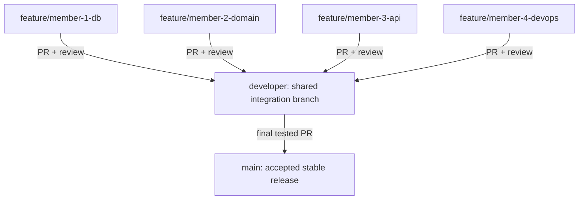
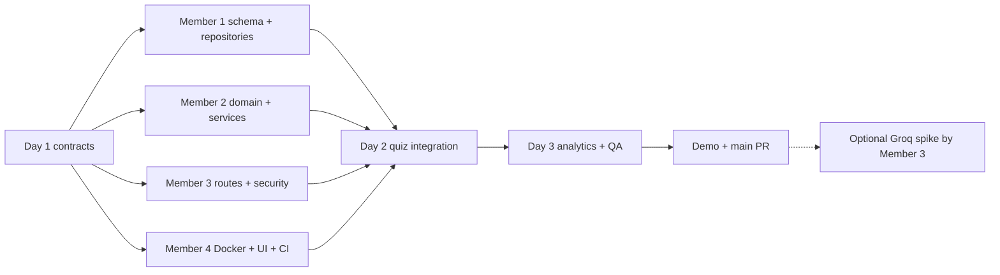

# StandupPulse — Three-Day, Four-Member Roadmap

**Based on:** [`design.md`](design.md), v2.0  
**Window:** Day 1 → Day 3 (relative workdays, not fixed calendar dates)  
**Deployment:** Local Docker Compose  
**Primary goal:** Working, tested MCQ quiz with time windows, admin post-submission edits, 1–2 attempts, immediate owner review, role-based analytics, GitHub workflow and logs  
**Explicit bonus:** Groq short-answer checking — **Member 3 only after the MVP is stable**

## Status notation

- `[ ]` **Not started** — no implementation verified.
- `[~]` **In progress / partially complete** — implementation exists but acceptance criteria are not fully met.
- `[x]` **Complete** — code, tests, integration and review are done; do not mark just because code was written.

**Current baseline:** The requirements and initial document drafts exist, but **no repository code/test status was provided**. Thus technical tasks start as `[ ]`. The drafted architecture/plan is marked `[~]` until the whole team approves it. Update this file during daily standup and PR reviews.

---

## 0. Shared conventions — all four members

### Branch and pull-request model

- All work starts from latest `developer`; individual branches PR into `developer`, **never directly into `main`**.
- Merge small, validated PRs frequently. Reserve shared `src/main.rs`, `.env.example`, `Cargo.toml`, `src/api/routes.rs` and `migrations/` for designated owners or explicit pairing.
- Prefer **squash merge** for member feature PRs, with useful PR descriptions. Do not force-push shared `developer` or `main`.
- PR title format: `feat(db): add immutable quiz revisions`, `fix(api): enforce deadline`, `test(domain): cover duplicate attempts`, `chore(ci): add checks`.
- Rust naming `snake_case` files/fields, `PascalCase` types; JSON/PostgreSQL `snake_case`; all endpoints under `/api/v1`.
- Every PR describes scope, tests run, schema/API changes, errors observed and a short verification screenshot or curl example when useful.
- Update status here at standup: mark `[~]` once started, `[x]` only after tests and PR review; add the PR link next to the task.
- **No generated `target/` directories, local `.env` or API credentials in Git.**

### Contracts that must be agreed before parallel work

| Contract | Owner | Required agreement |
|---|---|---|
| SQL schema + revision/session relationships | Member 1 | `QuizId`, revision IDs, foreign keys, status values, `max_attempts` |
| Business rules | Member 2 | Exactly `[start,end)`, session pinning, retry behavior, best score/rank |
| HTTP/DTO contract + error names | Member 3 | Route table and JSON fields from `design.md` |
| Environment + runtime | Member 4 | `DATABASE_URL`, `TOKEN_SECRET`, ports, healthchecks, log format |

**Integration gates:** every day's final checkpoint includes a smoke run with real PostgreSQL and a PR summary posted to the team. Avoid leaving all merges until Day 3.

---

## Day 1 — Foundation, shared contracts and first vertical slice

**Shared objective:** App starts, PostgreSQL migrates, users can register/login, admins can create a quiz draft, all four members agree on data and API types. The end of Day 1 should produce the first integration PR(s) to `developer`.

### Member 1 — Database and SQLx

- [ ] Create database migration folder and establish SQLx/PostgreSQL connectivity.
- [ ] Implement `users`, `teams`, `team_members`, `quizzes`, `quiz_eligibilities` schema and keys.
- [ ] Implement `quiz_revisions`, `question_versions`, and immutable history constraints.
- [ ] Implement `attempt_sessions`, `quiz_attempts`, `attempt_answers`, attempt-number uniqueness and active-session index.
- [ ] Provide repository interfaces and sample seed data for the other members.
- [ ] Run migration + rollback/reapply test against real local PostgreSQL.
- [ ] Open a small DB PR to `developer` and document schema names for Member 2 and Member 3.

**Day 1 handoff:** migrations work, schema documented, repository signatures shared.

### Member 2 — Domain logic and QA

- [ ] Freeze timing rule: 15-minute default, start inclusive and end exclusive.
- [ ] Define pure Rust domain models for Quiz, Revision, PublicQuestion, AnswerInput and AppError (coordinate with Member 3 DTOs).
- [ ] Implement pure `calculate_score()` and answer-set validation (missing/duplicate/foreign IDs).
- [ ] Implement `max_attempts` validation and pure `can_start()` / `can_submit()` decision helpers.
- [ ] Implement pure ranking rule: best percentage per user per revision, ties use competition rank.
- [ ] Write unit tests for scoring, invalid questions, boundary time and two-attempt policy.
- [ ] Open domain PR and share service signatures with Member 1/3.

**Day 1 handoff:** testable domain rules, accepted service interfaces, P0 unit tests.

### Member 3 — Axum API and security

- [ ] Agree on API DTO field names and status/error codes with Member 1/2.
- [ ] Scaffold Axum routes and standardized JSON `AppError` response.
- [ ] Implement registration/login and Argon2id hashing (no custom ASCII shifting).
- [ ] Add signed expiring token verification and backend role/eligibility middleware/helpers.
- [ ] Implement create-team, team-membership and admin create-quiz-draft endpoints using repository contracts.
- [ ] Add Swagger/OpenAPI or a clearly maintained API route document; avoid adding complicated UI dependencies.
- [ ] Test unauthorized/non-admin access; open API foundation PR.

**Day 1 handoff:** authenticated routes and frozen JSON contracts.

### Member 4 — Docker, CI, observability, simple frontend

- [ ] Add `.gitignore` (`**/target/`, `.env`, generated binaries) and `.env.example` without secrets.
- [ ] Create Dockerfile and `compose.yaml` for Rust API + PostgreSQL, with DB healthcheck and named volume.
- [ ] Add `tracing` request IDs, structured logs and `/health/live`, `/health/ready`.
- [ ] Create GitHub Actions format/lint/unit-test workflow (extend with DB tests on Day 2).
- [ ] Scaffold minimal web UI for login, quiz list and quiz create form; use the agreed API contract.
- [ ] Write local `README.md` bootstrap and `docker compose up --build` instructions.
- [ ] Test container startup and open DevOps PR.

**Day 1 handoff:** one-command local stack, visible healthcheck/logs, basic frontend shell.

### Day 1 integration checkpoint

- [~] Proposed system design and three-day delivery plan exist; team approval and decisions pending.
- [ ] Confirm editing policy, attempt-consumption policy, immediate answer reveal and per-revision rank in a 15-minute kickoff.
- [ ] Confirm one shared DTO/schema contract and avoid duplicated types.
- [ ] Verify Docker + PostgreSQL + Axum boot together from `developer`.
- [ ] Demonstrate admin login and draft-quiz creation through API.
- [ ] Complete peer review of first PRs; merge only passing foundation code.

**Gate to Day 2:** DB migrations succeed, app starts, authentication role checks work, unit tests pass.

---

## Day 2 — Full quiz workflow, revisions, timing and attempt limits

**Shared objective:** A member can start a timed MCQ quiz, submit safely, view results, and an admin can edit after submission without changing an old score. Start integrating by midday; do not isolate functionality until evening.

### Member 1 — Database and SQLx

- [ ] Implement atomic repository methods to publish quiz and capture eligible members.
- [ ] Implement insert-new-revision transaction that copies all questions and applies a change; preserve old versions.
- [ ] Implement session create/expire/find and session-pinned question lookup.
- [ ] Implement successful attempt number allocation and insert-attempt + insert-answers in one transaction.
- [ ] Add repository queries for own attempt history, own review and score aggregates.
- [ ] Test foreign keys, unique attempt numbers and rollback after forced failure.
- [ ] Submit incremental PR and pair with Member 2 on locking behavior.

**Day 2 handoff:** full revision/session/attempt persistence with SQL tests.

### Member 2 — Domain logic and QA

- [ ] Implement quiz publish/open/close/edit services using Member 1 repositories.
- [ ] Implement start-session rules using **DB time**, eligibility, max completed attempts and one active session.
- [ ] Implement submit service with deterministic scoring, exact question-set validation and per-session idempotent retry.
- [ ] Implement quiz-row lock ordering for submit, manual close and revision changes.
- [ ] Ensure admin editing after submit creates a new revision; old attempt remains pinned/unchanged.
- [ ] Add tests for 11:00–11:15 boundaries, double-submit, admin-close race, revision pinning and one-vs-two attempts.
- [ ] Pair with Member 1 for real-PostgreSQL concurrency tests and publish results.

**Day 2 handoff:** integrated service layer, P0 invariants demonstrated under DB tests.

### Member 3 — Axum API and security

- [ ] Implement publish, revise-question, close-quiz, start-session and fetch-session-questions routes.
- [ ] Implement submission route returning attempt number, remaining attempts, score and revision.
- [ ] Implement owner-only attempt review route with correct answers/explanations **after submit**.
- [ ] Implement admin-only revision history and enforce team role/ownership on every route.
- [ ] Validate protected answer fields never appear in pre-submit/public DTOs.
- [ ] Write API tests for missing token, wrong team, another user's attempt and attempt-limit errors.
- [ ] Update route documentation and open focused PR to `developer`.

**Day 2 handoff:** REST endpoints wired to services; access-control tests pass.

### Member 4 — Docker, CI, observability, simple frontend

- [ ] Build quiz play page with countdown, server-provided deadline, question rendering and submit button.
- [ ] Build after-submit review page showing score, correct option, explanation and remaining attempts.
- [ ] Build admin edit-question flow with revision warning and a basic close-quiz action.
- [ ] Add structured log events for create, publish, revise, start, submit, reject and close.
- [ ] Extend CI with PostgreSQL integration tests and Docker build check.
- [ ] Run local smoke test of two accounts and capture errors in `systems.md` or PR notes.
- [ ] Resolve UI/API mismatches with Member 3; open small PR.

**Day 2 handoff:** local end-to-end create → attempt → review and backend logging/CI.

### Day 2 integration checkpoint

- [ ] Admin publishes a 15-minute quiz with two attempts.
- [ ] Member submits once and sees correct answers/explanation immediately.
- [ ] Admin edits a question; existing attempt's score and review remain unchanged, next session uses new revision.
- [ ] Same-session retry is idempotent; second session consumes second attempt, third is rejected.
- [ ] API rejects after cutoff even with browser clock manipulation.
- [ ] Admin close versus submit concurrency test passes.
- [ ] Core PRs are merged to `developer` with passing CI.

**Gate to Day 3:** Full MCQ submission works safely end-to-end; protected answer data is not leaked.

---

## Day 3 — Analytics, release hardening and demo

**Shared objective:** Finish admin/member analytics, cover failure modes, polish only required UI, verify Docker + CI and merge `developer` into `main` for a stable local demonstration.

### Member 1 — Database and SQLx

- [ ] Implement/admin-review analytics queries: submissions, unique participants, per-user results, mean percentages.
- [ ] Implement revision-specific `RANK()` best-score queries, including correct ties.
- [ ] Verify query access scoping by team/revision and add necessary indexes.
- [ ] Add DB tests for two attempts, history retention, zero participants and multiple revisions.
- [ ] Confirm migrations work on a fresh volume and persistent data survives app container restart.
- [ ] Help fix any lock/contention or migration issue found during full smoke test.
- [ ] **Stretch after P0:** add basic closed-quiz PostgreSQL text search.

**Day 3 handoff:** proven analytics SQL and clean migration state.

### Member 2 — Domain logic and QA

- [ ] Verify per-revision best-score ranking and percentage calculations with ties.
- [ ] Run P0 end-to-end test matrix: cutoff, close race, post-submission edit, duplicate submits, auth, answer reveal, two attempts.
- [ ] Add integration tests for rollback, crashed/retried requests and simultaneous submissions.
- [ ] Review service-layer error mapping and prevent accidental historical score recomputation.
- [ ] Verify all edge cases in `design.md` sections 4 and 11 have a passing test or documented limitation.
- [ ] Prepare demonstration dataset and test summary for the final PR.
- [ ] **Stretch:** measure and document concurrent-load latency (do not claim unmeasured targets).

**Day 3 handoff:** signed-off core business acceptance tests and failures documented.

### Member 3 — Axum API and security

- [ ] Implement admin-only analytics endpoints and member-only `my-results` / rank endpoint.
- [ ] Recheck endpoint ownership, team isolation, token expiry, payload limits and error schemas.
- [ ] Verify no pre-submit answer key leak and no cross-user detailed result leak.
- [ ] Review OpenAPI/docs against the actual routes and include example curl commands.
- [ ] Resolve API/DTO inconsistencies and add final negative tests.
- [ ] Participate in final demo, PR review and post-merge smoke test.
- [ ] **BONUS ONLY — after all above are complete:** start Groq one-line-answer adapter behind `GROQ_ENABLED=false` (see bonus section below).

**Day 3 handoff:** hardened API and access control; Groq remains optional.

### Member 4 — Docker, CI, observability, simple frontend

- [ ] Implement simple admin analytics view and member results/rank view (no other members' detailed results).
- [ ] Ensure clock reaches zero and disables buttons while backend remains authoritative.
- [ ] Make Docker Compose clean-start + restart stable; verify `/health/live` and `/health/ready`.
- [ ] Review structured logs for request IDs, timings and expected audit events; check logs contain no secrets.
- [ ] Ensure CI passes `fmt`, `clippy`, unit tests, PostgreSQL integration tests and Docker build.
- [ ] Finalize README, sample credentials/setup instructions and local demo checklist.
- [ ] Coordinate final `developer` → `main` PR after all P0 acceptance checks pass.

**Day 3 handoff:** reproducible local demo, clean CI and merge-ready release notes.

### Day 3 release gate (all required)

- [ ] All four member contributions reviewed and merged into `developer`.
- [ ] Fresh `docker compose up --build` starts API, UI and database without manual hidden steps.
- [ ] Admin can edit after a candidate submits; old score and revision remain intact.
- [ ] The 15-minute `[start,end)` window and earlier admin close are enforced by API.
- [ ] Attempt limit 1 or 2 works; retry is idempotent and concurrency-safe.
- [ ] Correct answers and explanation are visible to an owner after submission, hidden from others.
- [ ] Member sees only own detailed results and revision rank; admin sees full analytics.
- [ ] All P0 tests pass; DB rollback and close/submission race have been exercised.
- [ ] CI passes, documentation is current, logs and health probes work.
- [ ] `developer` → `main` PR reviewed/merged; final demo executed from `main`.

---

## Critical dependency map

**Suggested daily syncs:** 15-minute kickoff to surface blockers and contract changes; mid-day paired integration of one feature; end-of-day PR review/smoke demo. This is a coordination suggestion, not an assumption of existing calendar bookings.

---

## Bonus backlog — Groq one-line answer checker (Member 3)

> **Do not move these into the required Day 1–3 gate.** The current MVP has MCQs only; Groq requires a separate short-answer data model and accuracy/oversight policy.

- [ ] **BONUS** Define `short_text` questions, typed answer submission and revision-safe data model.
- [ ] **BONUS** Create `AnswerChecker` Rust trait and `GroqChecker` implementation in `src/bonus/`.
- [ ] **BONUS** Add feature flag `GROQ_ENABLED=false` by default and configure `GROQ_API_KEY` securely.
- [ ] **BONUS** Prompt with rubric, expected answer and candidate one-line response; require validated structured response.
- [ ] **BONUS** Add timeouts, failure handling, strict token/cost budgets and manual-review fallback.
- [ ] **BONUS** Store model suggestion and human override/audit result; never overwrite a deterministic MCQ score.
- [ ] **BONUS** Write mocked API unit tests (correct/incorrect/ambiguous/timeout/invalid JSON/prompt injection).
- [ ] **BONUS** Evaluate against small labeled answer set; demo only if reliable and isolated.

**Bonus acceptance:** The deterministic MCQ system works with `GROQ_ENABLED=false` and during Groq outages. Uncertain short-answer grades remain pending review; the model cannot change permissions or historical data.

---

## Ownership and handoff summary

| Member | Day 1 | Day 2 | Day 3 | Mandatory sign-off |
|---|---|---|---|---|
| **1 — DB** | Schema + SQLx | Revision/session/attempt transactions | Analytics queries + DB proof | No duplicate attempts; history preserved |
| **2 — Domain/QA** | Rules + unit tests | Timing, submit, revision services | Race tests + acceptance suite | Correct deadlines, scores, ranks |
| **3 — API/Auth** | Auth, DTOs, routes | Quiz/submit/review routes | Analytics API + security | No unauthorized access or key leak |
| **4 — DevOps/UI** | Compose, CI, logs, UI shell | Play/review UI, integration CI | Dashboards, smoke + main PR | Reproducible local deployment |

**Project-wide next action:** Review and approve the four policy assumptions in `design.md` §1.3, then freeze schema and DTO names. The next meaningful status update should reflect **actual merged/tested code**, not estimates.
