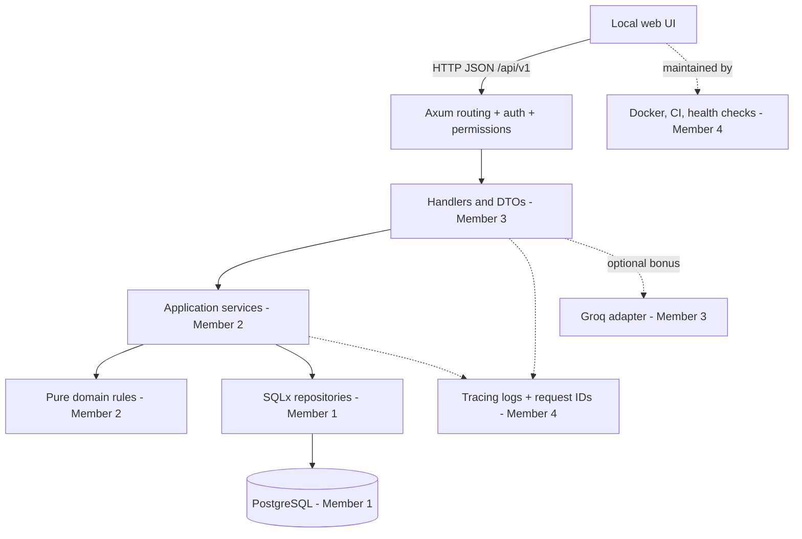
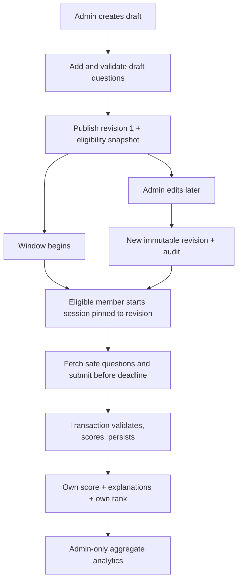
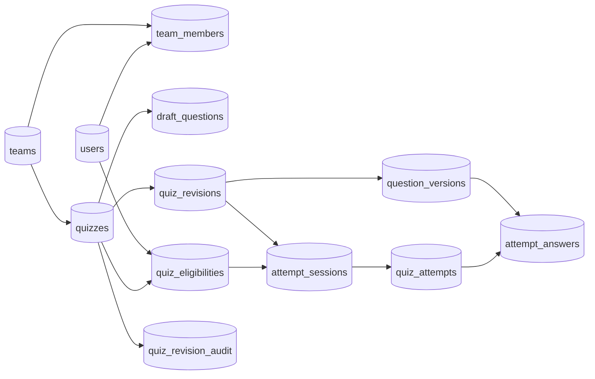
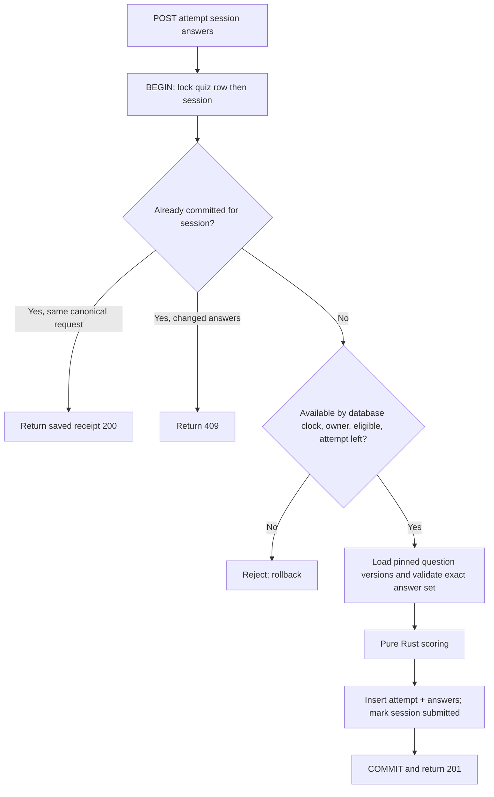

# Sphinx — System Design

**Version:** 2.1 (revised proposal)  
**Delivery:** Tuesday 17 to Thursday 19 November 2026 (three development days)  
**Team:** Four developers; local Docker Compose deployment  
**Status:** Proposed, not implemented or tested  
**Companion files:** `roadmap.md`, `AGENTS.md`, `docs/TEAM_CONVENTIONS.md`, `docs/API_CONTRACT.md`

> **Scope:** Deliver the deterministic MCQ quiz experience first. AI-assisted short-text grading through Groq is **bonus only** and must not delay delivery. A future internal engineering Stack Overflow / AI knowledge hub is outside the three-day scope.
>
> **Ownership decision required at kickoff:** This version retains the *latest uploaded layer-based responsibility split* (Member 1 database; Member 2 domain/services; Member 3 API/security; Member 4 UI/DevOps). An earlier plan assigned Member 3 participation/scoring. Do not mix the two plans without explicitly changing `AGENTS.md`, `docs/OWNERSHIP.md`, and `roadmap.md` together.

## 1. Overview and architecture

**Sphinx** is a local team quiz platform. Team admins create and publish a timed quiz. Eligible members answer multiple-choice questions, receive scores and explanations after submission, and see their own revision-specific ranks. Admins view team-wide analytics. An admin may edit a published quiz, but **immutable revisions** preserve the version seen by earlier participants and the integrity of past scores.

**Stack:** Rust, Tokio, Axum, Serde, SQLx, PostgreSQL, `tracing`, Docker Compose, GitHub Actions, and a thin local web UI. Local login uses Argon2id password hashing and signed, expiring access tokens (no OIDC). Never invent password encryption.



**Design principles:** One process / one shared database; backend-only authorization; database-enforced correctness for attempts; revision-pinned scores; no Redis, Kafka, microservices or AI dependency in the mandatory MVP.

## 2. Decisions and business rules

| Topic | Sphinx MVP contract |
| --- | --- |
| Question type | Multiple choice, one correct answer, 1–50 questions per quiz, 2–6 nonblank options each |
| Window | Default 15 minutes; `starts_at <= clock_timestamp() < ends_at`; end is **exclusive** |
| Attempts | Admin fixes `max_attempts` to **1 or 2** before publishing; successful submissions consume attempts |
| Unsubmitted sessions | Do not consume an attempt; may be resumed or expired by coordinated server logic |
| Duplicate requests | Same session + same canonical answers => existing result; same session + changed answers => `409` |
| Editing | Admin can edit after publication by creating a **new full immutable revision** with audit reason |
| In-progress revision | Attempt session pins a revision; edits do not alter an ongoing attempt |
| Previous scores | Remain attached to the original revision; no silent retroactive regrading |
| Closing | End of window or admin early close; server validates even if browser timer is wrong |
| Answer reveal | Owner sees correct answers/explanations **after each successful submission** |
| Analytics | Admin: team-wide. Member: only their attempt history, detail and own rank |
| Rank | Competition rank (e.g., 1, 1, 3) based on best score per participant **within the same revision** |
| Knowledge archive | Authorized search of closed quiz content is a **stretch goal** |
| Groq grading | Separate `short_text` question flow, disabled by default, **bonus** |

### Critical trade-off: immediate review versus two attempts

A user can read the correct answers after attempt 1 and reuse them on attempt 2. This satisfies the team's requested *learning quiz* behavior but is **not suitable for a secure assessment**. If competitive fairness matters, the team must approve a different reveal policy (e.g., show answers only when attempts are exhausted or after closure) before changing the contract.

### Time and close semantics

- A quiz running 11:00:00–11:15:00 accepts admissions up to **11:14:59.999…**, never at 11:15:00. There is no extra one-second grace period.
- Use UTC `TIMESTAMPTZ` in PostgreSQL. Evaluate cutoff using the database's `clock_timestamp()` **after acquiring required locks**. Display a countdown for convenience, not authority.
- Administrative closing and submission admission acquire the same parent quiz-row lock in the same order. If submit wins admission before closure/cutoff, it may commit afterward; if close wins, submit fails. Already committed identical retries remain readable after closure.
- A read-only quiz list may derive effective availability from start/end times without physically updating `status` at exactly the cutoff. UI should show effectively closed when the time has elapsed.

### Revision and session behavior

- Admin creates/edits **draft questions**. Publishing copies 1–50 validated draft questions into immutable revision 1 and snapshots eligible members.
- Subsequent edits create a **complete new revision**. Historical `question_versions` rows are never rewritten or deleted while referenced.
- An attempt session pins one `quiz_revision_id`. Its public questions use **question-version UUIDs**, not the cross-revision stable question UUIDs.
- Starting another session while one is active should return/resume the existing session or a documented `ACTIVE_SESSION_EXISTS` error **with a recovery path**; never strand a participant because they lost the start response.
- Starting, editing, closing and submitting must use a shared quiz-row lock protocol. Completed attempts remain historical.

## 3. Journeys



Admin may publish, close early, view all submissions and inspect edit history. Members may view available quizzes, start up to the configured number of attempts, submit, and review **only their own** responses. Nonmembers are denied resource access.

## 4. Data model



**Migration starting point** (`migrations/0001_init.sql`). The table schema below is adapted from the uploaded revision and adds `draft_questions`, which the source design omitted although it offered draft question CRUD. Apply, inspect and test the DDL in real PostgreSQL before treating it as final. Auth token choice must also be implemented consistently; signed stateless access tokens do not need a sessions table unless logout/revocation is added.

```sql
CREATE TABLE users (
    id UUID PRIMARY KEY DEFAULT gen_random_uuid(),
    username VARCHAR(50) NOT NULL UNIQUE,
    email VARCHAR(254) NOT NULL UNIQUE,
    password_hash TEXT NOT NULL,
    created_at TIMESTAMPTZ NOT NULL DEFAULT clock_timestamp()
);

CREATE TABLE teams (
    id UUID PRIMARY KEY DEFAULT gen_random_uuid(),
    name VARCHAR(100) NOT NULL UNIQUE,
    created_at TIMESTAMPTZ NOT NULL DEFAULT clock_timestamp(),
    deleted_at TIMESTAMPTZ
);

CREATE TABLE team_members (
    team_id UUID NOT NULL REFERENCES teams(id),
    user_id UUID NOT NULL REFERENCES users(id),
    role TEXT NOT NULL CHECK (role IN ('admin', 'member')),
    joined_at TIMESTAMPTZ NOT NULL DEFAULT clock_timestamp(),
    PRIMARY KEY (team_id, user_id)
);

CREATE TABLE quizzes (
    id UUID PRIMARY KEY DEFAULT gen_random_uuid(),
    team_id UUID NOT NULL REFERENCES teams(id),
    created_by UUID NOT NULL REFERENCES users(id),
    title VARCHAR(150) NOT NULL,
    description TEXT,
    status TEXT NOT NULL DEFAULT 'draft'
        CHECK (status IN ('draft', 'open', 'closed')),
    starts_at TIMESTAMPTZ,
    ends_at TIMESTAMPTZ,
    manually_closed_at TIMESTAMPTZ,
    max_attempts SMALLINT NOT NULL DEFAULT 1 CHECK (max_attempts IN (1, 2)),
    created_at TIMESTAMPTZ NOT NULL DEFAULT clock_timestamp(),
    CHECK (starts_at IS NULL OR ends_at IS NULL OR ends_at > starts_at),
    CHECK (status = 'draft' OR (starts_at IS NOT NULL AND ends_at IS NOT NULL))
);

CREATE TABLE draft_questions (
    id UUID PRIMARY KEY DEFAULT gen_random_uuid(),
    quiz_id UUID NOT NULL REFERENCES quizzes(id),
    stable_question_id UUID NOT NULL DEFAULT gen_random_uuid(),
    position INT NOT NULL CHECK (position >= 0),
    question_text TEXT NOT NULL CHECK (length(trim(question_text)) > 0),
    options JSONB NOT NULL,
    correct_option_index INT NOT NULL,
    explanation TEXT NOT NULL DEFAULT '',
    UNIQUE (quiz_id, stable_question_id),
    UNIQUE (quiz_id, position),
    CHECK (jsonb_typeof(options) = 'array'),
    CHECK (jsonb_array_length(options) BETWEEN 2 AND 6),
    CHECK (correct_option_index >= 0
        AND correct_option_index < jsonb_array_length(options))
);

CREATE TABLE quiz_revisions (
    id UUID PRIMARY KEY DEFAULT gen_random_uuid(),
    quiz_id UUID NOT NULL REFERENCES quizzes(id),
    revision_no INT NOT NULL CHECK (revision_no > 0),
    created_by UUID NOT NULL REFERENCES users(id),
    change_reason TEXT NOT NULL,
    created_at TIMESTAMPTZ NOT NULL DEFAULT clock_timestamp(),
    UNIQUE (quiz_id, revision_no),
    UNIQUE (quiz_id, id)
);

CREATE TABLE question_versions (
    id UUID PRIMARY KEY DEFAULT gen_random_uuid(),
    quiz_revision_id UUID NOT NULL REFERENCES quiz_revisions(id),
    stable_question_id UUID NOT NULL,
    position INT NOT NULL CHECK (position >= 0),
    question_text TEXT NOT NULL CHECK (length(trim(question_text)) > 0),
    options JSONB NOT NULL,
    correct_option_index INT NOT NULL,
    explanation TEXT NOT NULL DEFAULT '',
    UNIQUE (quiz_revision_id, position),
    UNIQUE (quiz_revision_id, stable_question_id),
    UNIQUE (quiz_revision_id, id),
    CHECK (jsonb_typeof(options) = 'array'),
    CHECK (jsonb_array_length(options) BETWEEN 2 AND 6),
    CHECK (correct_option_index >= 0
        AND correct_option_index < jsonb_array_length(options))
);

CREATE TABLE quiz_eligibilities (
    quiz_id UUID NOT NULL REFERENCES quizzes(id),
    user_id UUID NOT NULL REFERENCES users(id),
    PRIMARY KEY (quiz_id, user_id)
);

CREATE TABLE attempt_sessions (
    id UUID PRIMARY KEY DEFAULT gen_random_uuid(),
    quiz_id UUID NOT NULL REFERENCES quizzes(id),
    user_id UUID NOT NULL REFERENCES users(id),
    quiz_revision_id UUID NOT NULL,
    status TEXT NOT NULL DEFAULT 'in_progress'
        CHECK (status IN ('in_progress', 'submitted', 'expired')),
    started_at TIMESTAMPTZ NOT NULL DEFAULT clock_timestamp(),
    FOREIGN KEY (quiz_id, user_id)
        REFERENCES quiz_eligibilities(quiz_id, user_id),
    FOREIGN KEY (quiz_id, quiz_revision_id)
        REFERENCES quiz_revisions(quiz_id, id),
    UNIQUE (id, quiz_id, quiz_revision_id)
);

CREATE UNIQUE INDEX uq_active_session_per_user_quiz
    ON attempt_sessions(quiz_id, user_id)
    WHERE status = 'in_progress';

CREATE TABLE quiz_attempts (
    id UUID PRIMARY KEY DEFAULT gen_random_uuid(),
    session_id UUID NOT NULL UNIQUE REFERENCES attempt_sessions(id),
    quiz_id UUID NOT NULL REFERENCES quizzes(id),
    user_id UUID NOT NULL REFERENCES users(id),
    quiz_revision_id UUID NOT NULL,
    attempt_no SMALLINT NOT NULL CHECK (attempt_no IN (1, 2)),
    request_hash CHAR(64) NOT NULL,
    score INT NOT NULL CHECK (score >= 0),
    total_questions INT NOT NULL CHECK (total_questions BETWEEN 1 AND 50),
    submitted_at TIMESTAMPTZ NOT NULL DEFAULT clock_timestamp(),
    UNIQUE (quiz_id, user_id, attempt_no),
    UNIQUE (id, quiz_revision_id),
    FOREIGN KEY (quiz_id, quiz_revision_id)
        REFERENCES quiz_revisions(quiz_id, id),
    FOREIGN KEY (quiz_id, user_id)
        REFERENCES quiz_eligibilities(quiz_id, user_id),
    CHECK (score <= total_questions)
);

CREATE TABLE attempt_answers (
    attempt_id UUID NOT NULL,
    quiz_revision_id UUID NOT NULL,
    question_version_id UUID NOT NULL,
    selected_option_index INT NOT NULL CHECK (selected_option_index >= 0),
    is_correct BOOLEAN NOT NULL,
    PRIMARY KEY (attempt_id, question_version_id),
    FOREIGN KEY (attempt_id, quiz_revision_id)
        REFERENCES quiz_attempts(id, quiz_revision_id),
    FOREIGN KEY (quiz_revision_id, question_version_id)
        REFERENCES question_versions(quiz_revision_id, id)
);

CREATE TABLE tags (
    id UUID PRIMARY KEY DEFAULT gen_random_uuid(),
    team_id UUID NOT NULL REFERENCES teams(id),
    name VARCHAR(50) NOT NULL,
    UNIQUE (team_id, name)
);

CREATE TABLE question_tags (
    question_version_id UUID NOT NULL REFERENCES question_versions(id),
    tag_id UUID NOT NULL REFERENCES tags(id),
    PRIMARY KEY (question_version_id, tag_id)
);

CREATE TABLE quiz_revision_audit (
    id UUID PRIMARY KEY DEFAULT gen_random_uuid(),
    quiz_id UUID NOT NULL REFERENCES quizzes(id),
    revision_id UUID NOT NULL REFERENCES quiz_revisions(id),
    editor_id UUID NOT NULL REFERENCES users(id),
    action TEXT NOT NULL,
    reason TEXT NOT NULL,
    created_at TIMESTAMPTZ NOT NULL DEFAULT clock_timestamp()
);

CREATE INDEX idx_quizzes_team_status ON quizzes(team_id, status);
CREATE INDEX idx_quizzes_window ON quizzes(starts_at, ends_at);
CREATE INDEX idx_questions_revision ON question_versions(quiz_revision_id, position);
CREATE INDEX idx_sessions_quiz_user ON attempt_sessions(quiz_id, user_id);
CREATE INDEX idx_attempts_quiz_user ON quiz_attempts(quiz_id, user_id);
CREATE INDEX idx_attempts_revision ON quiz_attempts(quiz_revision_id);
CREATE INDEX idx_attempts_submitted_at ON quiz_attempts(submitted_at);
```

**Mandatory service/database invariants:**

1. Only team admins create/publish/revise/close; eligibility is frozen at publish.
2. A revision contains 1–50 valid questions; question options are nonblank text; prevent revision mutation after insert.
3. Session's quiz, user, revision and question-version IDs must agree; never trust client-supplied scores or revision IDs.
4. A submission contains exactly one response for each pinned question with a valid index.
5. Hold parent quiz lock while checking the deadline and successful-attempt count; `UNIQUE (quiz_id,user_id,attempt_no)` and `session_id UNIQUE` enforce integrity.
6. `quiz_attempts`, `attempt_answers`, and the session status update commit **atomically** or all roll back.
7. A partial unique index prevents more than one `in_progress` session, but **does not expire sessions by itself**. Expire or resume stale sessions explicitly under locks.
8. Tags, question revisions and attempt histories must respect team ownership and access controls.
9. If published data is to be immutable, enforce it by limiting write paths and testing them; `FOREIGN KEY` constraints alone do not prevent updates to existing revision rows.

## 5. REST API contract

**Prefix:** `/api/v1`. JSON uses `snake_case`. IDs are UUIDs. Server obtains the user from the verified access token. Only registration/login (and configured health endpoints) are public.

| Method | Path | Authorization / purpose |
| --- | --- | --- |
| POST | `/auth/register` | Public account creation |
| POST | `/auth/login` | Public login, obtain expiring token |
| GET | `/me` | Own profile |
| POST | `/teams` | Authenticated; creator becomes admin |
| GET | `/teams` | Own teams |
| POST | `/teams/{team_id}/members` | Admin adds members |
| POST | `/teams/{team_id}/quizzes` | Admin creates draft, window and max attempts |
| POST | `/quizzes/{quiz_id}/questions` | Admin adds draft question |
| PATCH | `/quizzes/{quiz_id}/questions/{stable_question_id}` | Admin draft edit or published new revision |
| POST | `/quizzes/{quiz_id}/publish` | Admin validates, snapshots eligibility/revision |
| POST | `/quizzes/{quiz_id}/close` | Admin closes early |
| GET | `/quizzes/{quiz_id}/revisions` | Admin audit/revision list |
| GET | `/teams/{team_id}/quizzes` | Authorized list, no answer key |
| GET | `/quizzes/{quiz_id}` | Authorized metadata, no answer key |
| POST | `/quizzes/{quiz_id}/attempt-sessions` | Eligible member starts session |
| GET | `/attempt-sessions/{session_id}/questions` | Owner-only public pinned questions |
| POST | `/attempt-sessions/{session_id}/submit` | Owner submits; atomic, idempotent |
| GET | `/attempts/{attempt_id}/review` | Attempt owner or team admin; after submit |
| GET | `/quizzes/{quiz_id}/my-results` | Own attempts, best score, rank |
| GET | `/quizzes/{quiz_id}/analytics` | Admin aggregate analytics |
| GET | `/teams/{team_id}/analytics` | Admin aggregate analytics |
| GET | `/teams/{team_id}/knowledge` | Authorized closed-quiz search **stretch** |
| GET | `/health/live`, `/health/ready` | Internal/local health monitoring |

Write routes consistently with this table and `docs/API_CONTRACT.md`; do not mix the old `/quizzes/{id}/submit` endpoint with the new session-based endpoint.

**Example submission:**

```json
{
  "answers": [
    {"question_id": "11111111-1111-4111-8111-111111111111", "selected_option_index": 1},
    {"question_id": "22222222-2222-4222-8222-222222222222", "selected_option_index": 0}
  ]
}
```

**Example success:**

```json
{
  "attempt_id": "33333333-3333-4333-8333-333333333333",
  "attempt_number": 1,
  "max_attempts": 2,
  "remaining_attempts": 1,
  "quiz_revision_number": 1,
  "score": 2,
  "total_questions": 2,
  "percentage": 100.0,
  "status": "submitted",
  "review_available": true
}
```

**Error shape:**

```json
{"error": {"code": "ATTEMPT_LIMIT_REACHED", "message": "No attempts remaining", "request_id": "req_example"}}
```

| Status | Typical meaning |
| --- | --- |
| `201` | New attempt saved |
| `200` | Successful GET or identical retry |
| `400`/`422` | Invalid submitted answer set |
| `401` | Missing/invalid authentication |
| `403`/`404` | Unauthorized or hidden resource |
| `409` | Attempt limit, changed retry, closed quiz or conflicting active session |
| `429` | Rate limited |
| `500`/`503` | Internal/dependency failure; safe error message |

## 6. Submission and idempotency



Canonicalize `(question_version_id, selected_option_index)` pairs by sorting by ID, serialize deterministically, and compute SHA-256 as a **retry fingerprint only**, never password storage. A real second attempt uses a **new session**. Database uniqueness and locked transaction paths protect against concurrent duplicates and racing close/edit operations. Avoid external LLM calls while a transaction lock is held.

## 7. Analytics and permissions

- **Admin:** attempt history, per-user scores, averages, distinct participants, revision-specific trends, edit audit.
- **Member:** own attempts, own per-question correctness/explanations, own best score and own rank; cannot list other members' detailed results.
- `participation_rate = unique_submitting_users / eligible_users_at_publish * 100`; return `null` for zero denominator.
- For revision R, calculate each user's **best percentage** among their submissions on R, then compute competition rank (`RANK()` SQL window function). Display which revision a rank belongs to.
- Team-wide historical knowledge search can expose correct answers after quiz closure under the agreed policy; before close, only the attempt owner can see their own submitted review.

## 8. Security, logging, testing and local deployment

- Argon2id password hashes with random salts; signed and expiring access tokens; verify identity and team role on each backend route. Keep tokens and secrets out of logs and Git.
- SQLx bound parameters, controlled JSON size, login rate limiting, CORS allowlist and ownership checks; no raw student answers or private answer keys in tracing.
- `tracing` logs should include safe request IDs, event names, resource IDs, revision number, outcome and duration. Member 4 owns observability integration; all members emit meaningful events.
- CI should run `cargo fmt --all -- --check`, `cargo clippy --all-targets -- -D warnings`, `cargo test`, PostgreSQL integration tests and a local Docker build/smoke check. Never claim checks passed without running them.
- Compose services: `api`, `db` using `postgres:17-alpine`, persistent volume, database healthcheck. Database name **`sphinx`**; local service binds to `127.0.0.1:8000`. `DATABASE_URL=postgres://app:$DB_PASSWORD@db:5432/sphinx` is an illustrative in-container value, not a production secret template.

### Highest-priority tests

- Quiz starts/ends at proper exclusive UTC window boundaries; admin close versus submission race.
- Admin edits after an attempt or during a session; original revision and score remain intact.
- Attempt limits 1/2, two simultaneous starts, two simultaneous submissions, identical retry, changed retry.
- Partial failure during answer inserts rolls back attempt and session state.
- Wrong team, role or attempt owner denied; pre-submit safe questions omit key; post-submit owner-only review works.
- Revision-specific best-score/ranking ties; database unavailable; restart and replay.

## 9. Ownership and 3-day implementation

This **retains the latest attached proposal** (layer ownership):

| Member | Main owner | Files |
| --- | --- | --- |
| 1 | PostgreSQL, schema, SQLx repositories | `migrations/`, `src/repository/` |
| 2 | Quiz domain, timing, revisions, attempt/scoring services, tests | `src/domain/`, `src/services/` |
| **3 (you)** | Axum routes/handlers, auth/role enforcement, DTOs, errors, API tests | `src/api/`, plus bonus `src/bonus/groq_checker.rs` |
| 4 | DevOps, logging, CI, frontend, integration/demo | `web/`, `Dockerfile`, `compose.yaml`, `.github/workflows/`, observability |

This is **not the same** as the earlier feature-based split. Choose and ratify one division at kickoff. See `docs/OWNERSHIP.md` and the `roadmap.md` calendar.

## 10. Groq one-line grading — BONUS, not MVP

- MCQs remain scored by pure Rust comparisons; never require an LLM to grade MCQs.
- Add a separately versioned `short_text` question and answer schema, with grading status such as `pending_review`, before enabling the bonus.
- Implement a pluggable `AnswerChecker` trait (one implementation uses Groq; tests use a fake); do not invoke models while holding PostgreSQL transaction locks.
- Pass only approved question/rubric/candidate-answer context; validate structured output; never blindly trust model confidence.
- On model error, timeout, or uncertain grading, mark `pending_review` and support an admin override with audit history.
- Protect PII and company content; keep `GROQ_API_KEY` in environment configuration, `GROQ_ENABLED=false` by default, and do not make CI depend on external Groq access.

## 11. Future Sphinx Knowledge Hub — after Thursday

An internal Stack Overflow-like module for developer incidents and verified fixes can reuse identity, teams, PostgreSQL, logging, search and permission boundaries. Add dedicated `knowledge_entries` tables, exact/keyword search first, optional semantic search later, and AI-assisted debugging as a separate phase. Do **not** build it as a mandatory part of this three-day quiz project.

## 12. Definition of Done

A local demonstration is complete when secure login works, admins can publish and revise, questions are revision pinned, server enforces the 15-minute window and 1/2 attempts, concurrent retries are safe, owner review and restricted analytics work, CI/tests pass, Docker starts and logs are understandable. Groq and internal Stack Overflow are **not** acceptance requirements.
